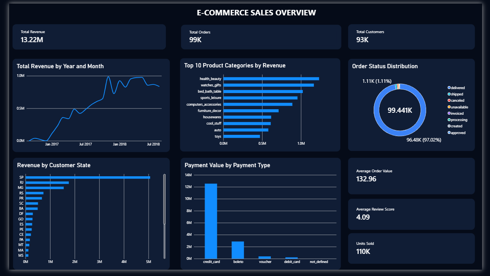
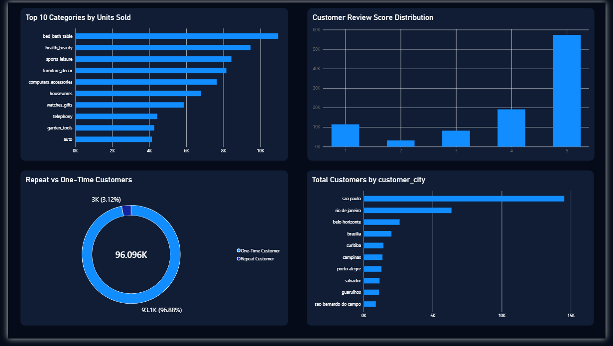
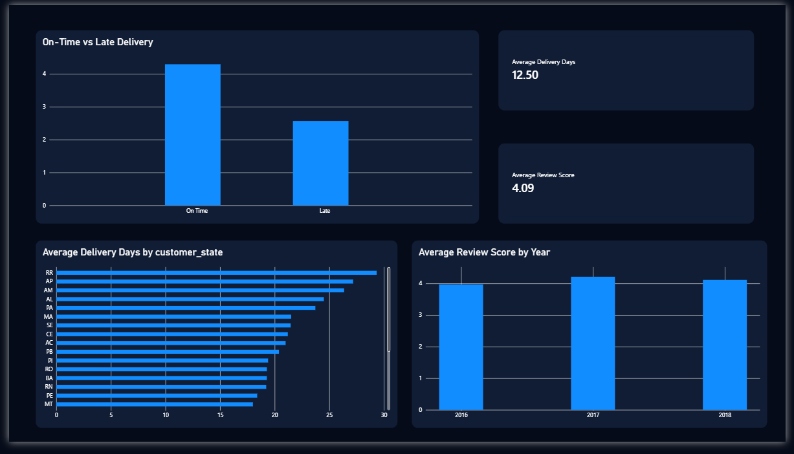

# E-Commerce Business Intelligence & Sales Analytics

## Project Overview

An end-to-end data analytics project using the Brazilian E-Commerce Public Dataset by Olist. This project analyzes sales performance, customer behavior, product categories, payment methods, delivery performance, and customer satisfaction.

## Objectives

- Analyze overall sales and revenue.
- Identify top-performing product categories.
- Understand customer purchasing behavior.
- Analyze regional sales performance.
- Evaluate delivery delays and customer satisfaction.
- Generate actionable business recommendations.

## Tools & Technologies

- **Python** – Data cleaning and exploratory data analysis
- **Pandas & NumPy** – Data processing
- **Matplotlib & Seaborn** – Data visualization
- **MySQL** – Database management and SQL analysis
- **Power BI** – Interactive dashboards
- **Git & GitHub** – Version control

## Dataset

**Brazilian E-Commerce Public Dataset by Olist**

Source: [Olist Dataset – Kaggle](https://www.kaggle.com/datasets/olistbr/brazilian-ecommerce)

The dataset contains approximately 100,000 orders and multiple related CSV files.

## Project Structure

```text
ecommerce-business-intelligence/
├── data/
│   ├── raw/
│   └── processed/
├── notebooks/
│   └── 01_exploratory_data_analysis.ipynb
├── sql/
├── powerbi/
├── reports/
├── screenshots/
└── README.md
```

## Analysis Performed

### Python

- Data loading and inspection
- Missing-value treatment
- Duplicate analysis
- Data type conversion
- Exploratory data analysis
- Data cleaning and export

### MySQL

- Sales performance analysis
- Monthly revenue trends
- Product category analysis
- Customer analysis
- Regional sales analysis
- Delivery performance analysis
- Payment method analysis
- Customer satisfaction analysis

### Power BI Dashboard

The interactive dashboard contains three pages:

#### Page 1 – Executive Overview

- Total Revenue
- Total Orders
- Total Customers
- Average Order Value
- Units Sold
- Average Review Score
- Monthly Revenue Trend
- Product Category Revenue
- Order Status Distribution
- Revenue by State
- Payment Analysis

#### Page 2 – Product & Customer Insights

- Top Categories by Units Sold
- Top Cities by Customer Count
- Customer Review Distribution
- Repeat vs One-Time Customers

#### Page 3 – Delivery & Customer Satisfaction

- Average Delivery Days
- Average Review Score
- Delivery Time by State
- On-Time vs Late Delivery Analysis

## Dashboard Screenshots

### 1. Executive Overview



### 2. Product & Customer Insights



### 3. Delivery & Customer Satisfaction



## Key Business Metrics

| Metric | Result |
|---|---:|
| Total Revenue | R$13.22M |
| Total Orders | 99,441 |
| Units Sold | Approximately 110K |
| Average Order Value | R$132.96 |
| Average Review Score | 4.09 |

*Metrics should be interpreted using their respective filters and calculation definitions.*

## Key Business Insights

- Health & Beauty was the highest-revenue product category.
- São Paulo contributed the largest share of revenue.
- Credit cards were the most widely used payment method.
- Month-to-month customer purchasing behavior showed a high concentration of one-time buyers.
- Late deliveries were associated with lower average customer review scores.

## Project Status

Completed – Data cleaning, SQL analysis, Power BI dashboard development, and project documentation.

## Author

**Bilal Lukman**